# AI Agent Identity, Delegation, and OPA Security System

A Spring AI MCP server that verifies Agent identity, delegated authority, request integrity, OPA policy, user approval, and signed audit evidence before executing a tool.

> This repository is a security architecture lab. Do not use the local in-memory stores, ephemeral keys, or the `local` Spring profile unchanged in production.

## Features

| Area | Implementation | Status |
| --- | --- | --- |
| Agent identity | Ed25519, `did:key`, Challenge signing, one-time use | Implemented |
| Delegation | Signed tokens, trusted root issuers, chain verification | Implemented |
| Attenuation | action/resource/expiry/depth/audience constraints | Implemented |
| Replay protection | One-time Challenge and `requestId` checks | Implemented |
| Policy | OPA Rego decision with fail-closed behavior | Implemented |
| Risk approval | Risk classification and request-bound approval token | Core implemented |
| Audit evidence | Hash chain, Gateway signature, Merkle root | Core implemented |
| AWS extension | DynamoDB, KMS, S3 Object Lock, Terraform | Experimental |

## Architecture

```mermaid
flowchart LR
    C[MCP Client / Agent] --> T[Spring AI MCP Tools]
    T --> G[SecurityGateway]
    G --> I[DID + Challenge]
    I --> D[Delegation Verifier]
    D --> R[Replay Protection]
    R --> O[OPA Policy]
    O --> A[Risk + Approval]
    A --> S[Business Service]
    S --> L[Signed Audit Ledger]
```



- **OPA (PDP)** returns `ALLOW`, `ALLOW_LOG`, `REQUIRE_APPROVAL`, or `DENY`.
- **SecurityGateway (PEP)** enforces verification order and never calls a business service after denial.
- **Business services** contain only the requested operation.

## Security Pipeline

```text
MCP request
  -> DID and Challenge signature
  -> delegation signature and chain
  -> one-time requestId
  -> OPA policy
  -> risk and user approval
  -> execution
  -> signed audit event
```

Any failed stage stops execution.

## Delegation Attenuation

```text
child.actions subset-of parent.actions
child.resources subset-of parent.resources
child.expiresAt <= parent.expiresAt
child.delegationDepth = parent.delegationDepth + 1
child.delegationDepth <= maxDepth
child.issuer = parent.subject
child.audience = parent.audience
```

The server rejects escalation instead of silently narrowing the token.

## Project Layout

```text
en/
├── Dockerfile
├── pom.xml
├── README.md
├── opa/policies/agent_authz.rego
├── infra/aws/main.tf
├── src/main/java/io/github/straightsang/agentsecurity/mcp/
│   ├── identity/       # Ed25519, DID, Challenge, Agent proof
│   ├── delegation/     # Token canonicalization, signing, revocation
│   ├── security/       # Chain verification, replay, request hashes
│   ├── opa/            # OPA input and HTTP client
│   ├── approval/       # Risk classification and approval tokens
│   ├── gateway/        # Enforced security pipeline
│   ├── audit/          # Signed ledger, Merkle tree, anchors
│   ├── tools/          # MCP entry points
│   ├── service/        # Business operations
│   └── state/          # In-memory and DynamoDB stores
├── src/main/resources/application.yml
└── src/test/java/io/github/straightsang/agentsecurity/mcp/
    ├── demo/           # DID, Challenge, and delegation CLIs
    └── ...             # Unit and security tests
```

## Requirements

- Windows 10/11 with WSL2 Ubuntu
- Docker Desktop with WSL integration
- Git
- Internet access for the first image and dependency download

Local Java and Maven installations are optional.

## Quick Start

### 1. Open the English project

```bash
cd /mnt/c/Users/<username>/OneDrive/Desktop/IHHH_AI_STUDY/W7_DID/mcp-server-spring/en
```

### 2. Create the shared Docker network

```bash
docker network create agent-security-net
```

If it already exists, continue.

### 3. Start OPA

```bash
docker run -d \
  --name opa \
  --network agent-security-net \
  -p 8181:8181 \
  -v "$PWD/opa/policies:/policies:ro" \
  openpolicyagent/opa:latest \
  run --server --addr=0.0.0.0:8181 /policies
```

```bash
curl http://127.0.0.1:8181/health
```

HTTP 200 with `{}` means OPA is healthy.

### 4. Create User and Agent DIDs

The CLIs live under `src/test` and are not packaged in the runtime JAR.

```bash
docker run --rm -it \
  -v "$PWD:/workspace" \
  -v maven-repository:/root/.m2 \
  -w /workspace \
  maven:3.9-eclipse-temurin-21 \
  mvn -q -DskipTests test-compile \
  org.codehaus.mojo:exec-maven-plugin:3.5.0:java \
  -Dexec.mainClass=io.github.straightsang.agentsecurity.mcp.demo.LocalIdentitySetupCli \
  -Dexec.classpathScope=test
```

```bash
ls -la .secrets
cat .secrets/user.did
cat .secrets/agent.did
```

Never publish `*-private.pkcs8.b64` files.

### 5. Configure trusted DIDs

Add the **user DID** to `src/main/resources/application.yml`:

```yaml
security:
  opa:
    url: ${OPA_URL:http://127.0.0.1:8181}
    timeout: 2s
  delegation:
    audience: agent-security-mcp
    max-depth: 3
    trusted-issuers:
      - "did:key:YOUR_USER_DID"
  approval:
    token-ttl: 2m
    trusted-approvers:
      - "did:key:YOUR_USER_DID"
```

- `trusted-issuers` contains root delegation issuers.
- `trusted-approvers` contains high-risk approval signers.
- Do not add the Agent DID.
- Empty lists fail closed.

### 6. Build and run

```bash
docker build -t agent-security-mcp-en .
```

The Docker build runs `mvn clean verify` and stops on test failure.

```bash
docker run --rm \
  --name agent-security-mcp-en \
  --network agent-security-net \
  -p 8000:8000 \
  -e SERVER_ADDRESS=0.0.0.0 \
  -e OPA_URL=http://opa:8181 \
  -e SPRING_PROFILES_ACTIVE=local \
  agent-security-mcp-en
```

```bash
curl http://127.0.0.1:8000/ping
curl http://127.0.0.1:8000/actuator/health
```

Expected results:

```json
{"status":"Healthy"}
```

```json
{"groups":["liveness","readiness"],"status":"UP"}
```

Without `SPRING_PROFILES_ACTIVE=local`, `/ping` may return 401.

## Challenge Signing

Issue a Challenge:

```bash
AGENT_DID=$(cat .secrets/agent.did)

curl -X POST http://127.0.0.1:8000/identity/challenges \
  -H "Content-Type: application/json" \
  -d "{\"agentDid\":\"$AGENT_DID\"}"
```

Sign the response's `challenge` value, not its `challengeId`:

```bash
CHALLENGE='VALUE_FROM_THE_RESPONSE'

docker run --rm -it \
  -v "$PWD:/workspace" \
  -v maven-repository:/root/.m2 \
  -w /workspace \
  maven:3.9-eclipse-temurin-21 \
  mvn -q -DskipTests test-compile \
  org.codehaus.mojo:exec-maven-plugin:3.5.0:java \
  -Dexec.mainClass=io.github.straightsang.agentsecurity.mcp.demo.ChallengeSignerCli \
  -Dexec.classpathScope=test \
  -Dexec.args="$CHALLENGE"
```

A Challenge is consumed only after successful verification. A forged signature does not invalidate the legitimate Agent's Challenge.

## Delegation Token

Create a 15-minute token delegating `calculator_add` on `calculator`:

```bash
docker run --rm -it \
  -v "$PWD:/workspace" \
  -v maven-repository:/root/.m2 \
  -w /workspace \
  maven:3.9-eclipse-temurin-21 \
  mvn -q -DskipTests test-compile \
  org.codehaus.mojo:exec-maven-plugin:3.5.0:java \
  -Dexec.mainClass=io.github.straightsang.agentsecurity.mcp.demo.DelegationTokenCli \
  -Dexec.classpathScope=test
```

```bash
cat .secrets/root-delegation-token.json
```

| Field | Meaning |
| --- | --- |
| `issuer` | User DID delegating authority |
| `subject` | Agent DID receiving authority |
| `audience` | MCP server allowed to accept the token |
| `actions` | Allowed operations |
| `resources` | Allowed resources |
| `issuedAt`, `expiresAt` | Validity window |
| `delegationDepth` | Delegation level; root is 0 |
| `signature` | Issuer Ed25519 signature |

## MCP Tools

The Streamable HTTP endpoint is `/mcp`.

### `calculator_add`

Adds two integers after all security checks pass. Inputs include `a`, `b`, `agentDid`, `challengeId`, `challengeSignature`, a fresh `requestId`, `delegationChain`, and an optional `approvalToken`.

### `read_lab_document`

Reads a regular file inside the sandbox after the same security pipeline. Symbolic links that resolve outside the sandbox are rejected.

## OPA Policy

The policy at `opa/policies/agent_authz.rego` denies by default:

```rego
default allow := false
```

OPA permits further evaluation only after identity and delegation verification, actor/subject equality, and action/resource scope checks. Connection failures, timeouts, and malformed responses fail closed.

## Risk Approval

| Outcome | Behavior |
| --- | --- |
| `ALLOW` | Execute immediately |
| `ALLOW_LOG` | Execute with enhanced logging |
| `REQUIRE_APPROVAL` | Verify a signed user approval token |
| `DENY` | Block execution |

`POST /approval/prepare` returns the risk explanation and deterministic `requestHash`. Approval tokens are bound to the request, Agent, target, approver, and validity window. Modified, expired, or reused approvals are rejected.

## Signed Audit Ledger

The Gateway records allowed and denied requests with a canonical request hash, response hash, previous-event hash, decision, Gateway DID, Gateway signature, and Merkle batching. The default local external anchor does not publish to a network.

## Tests and Attack Validation

```bash
docker build -t agent-security-mcp-en .
```

Expected baseline:

```text
Java source files: 80
Tests run: 32
Failures: 0
Errors: 0
```

Security-focused suite:

```bash
docker run --rm \
  -v "$PWD:/workspace" \
  -v maven-repository:/root/.m2 \
  -w /workspace \
  maven:3.9-eclipse-temurin-21 \
  mvn -B -ntp \
  -Dtest=DelegationVerifierTest,CommandIntegrityVerifierTest,SignedAuditLedgerTest \
  test
```

Validated attacks include signed-token tampering, child action/resource expansion, longer child expiry, revoked-token reuse, an untrusted root issuer, command modification after signing, and signing with a different private key. Audit hash-chain, Gateway signature, and Merkle-root checks also pass.

## AWS Extension

`infra/aws/main.tf` defines experimental DynamoDB security/audit tables, an asymmetric KMS signing key, and a versioned S3 Object Lock bucket.

```bash
cd infra/aws
terraform init
terraform plan
```

`terraform apply` creates billable resources. Review the AWS account, Region, IAM permissions, retention, and deletion behavior first.

## Current Limitations

Before production deployment:

- replace local state with Redis or DynamoDB;
- move private keys to KMS, HSM, or an OS keystore;
- implement a real approval UI or wallet client;
- enable a durable external anchor;
- add an MCP integration client for `initialize` and `tools/call`;
- add TLS, JWT/OIDC, rate limiting, monitoring, and failure tests;
- consider JWS/JWT or Verifiable Credentials for delegation; and
- consolidate experimental audit implementations into one production path.


## Design Principle

> Do not trust an LLM's claim. Verify identity, authority, policy, signatures, and audit evidence in code.
