# AI Agent DID, Delegation & OPA Security MCP Server

Spring Boot와 Spring AI MCP Server로 만든 **AI Agent DID 신원/권한위임/정책집행 보안 실험 프로젝트**.

> 보안 구조 학습/검증용 프로젝트
> 참고한 자료
> [CAPMAS: Capability-Based Delegation of Privileges in Multi-Agent Systems](https://arxiv.org/abs/2609.06500)
> [AI Agents with DID and Verifiable Credentials](https://arxiv.org/abs/2511.02841)
----


모든 MCP 도구 요청은 아래 증거를 순서대로 검증한다.

1. Ed25519 개인키 소유 증명
2. `did:key` 기반 Agent 신원
3. 서명된 권한 위임 체인
4. `requestId` 재사용 방지
5. OPA 정책 판단
6. 고위험 작업의 사용자 승인
7. 요청/응답 해시와 서명 감사 원장


## 목차

- [핵심 기능](#핵심-기능)
- [전체 구조](#전체-구조)
- [보안 검증 순서](#보안-검증-순서)
- [권한 축소 규칙](#권한-축소-규칙)
- [프로젝트 구조](#프로젝트-구조)
- [빠른 시작](#빠른-시작)
- [사용자와 Agent DID 생성](#사용자와-agent-did-생성)
- [신뢰 DID 등록](#신뢰-did-등록)
- [서버 실행](#서버-실행)
- [Challenge 발급과 서명](#challenge-발급과-서명)
- [위임 토큰 생성](#위임-토큰-생성)
- [MCP 도구](#mcp-도구)
- [Ground Truth와 확장 기능](#ground-truth와-확장-기능)
- [테스트와 공격 검증](#테스트와-공격-검증)
- [AWS 확장](#aws-확장)
- [현재 한계와 다음 작업](#현재-한계와-다음-작업)
- [GitHub 업로드 전 확인](#github-업로드-전-확인)

## 핵심 기능

| 영역 | 구현 내용 | 상태 |
| --- | --- | --- |
| Agent 신원 | Ed25519, `did:key`, Challenge 서명, 일회 사용 | 구현 |
| 권한 위임 | 서명된 위임 토큰, root issuer 신뢰, 체인 검증 | 구현 |
| 권한 감쇠 | action/resource/만료/depth/audience 축소 강제 | 구현 |
| Replay 방지 | Challenge와 `requestId` 재사용 거부 | 구현 |
| 정책 판단 | OPA Rego 정책, fail-closed 처리 | 구현 |
| 위험 승인 | 위험 분류, 요청 해시 결합, 승인 토큰 서명/만료/일회 사용 | 핵심 구현 |
| 감사 증거 | request/response hash, hash chain, Gateway 서명, RFC 6962 Merkle 트리, 포함 증명, 서명된 체크포인트, 파일 영속화 | 구현 |
| 외부 앵커 | OpenTimestamps(.ots 요청/저장), 로컬/S3 Object Lock 구현 경계 | 선택 구성 |
| 권한 그래프 | 서명 원장에서 재구성, 체인 교집합 실효 권한, 이상 징후 탐지, 연쇄 폐기 | 구현 |
| 도구 계보 | 도구 설명/코드 해시 고정, rug pull 격리, 승인 토큰으로만 재허용 | 구현 |
| 다중 탐지기 판정 | 규칙 + 어휘 탐지기 + 외부 모델 서버(HTTP) 비대칭 결합 | 구현(모델 서버는 별도 준비) |
| 승인 확장 | M-of-N 승인, 한도형 사전 승인(승인 채널), 위임 체인까지 묶은 요청 해시 | 구현 |
| 속도 제한 | Agent DID별 분당 요청 수 제한 | 구현 |
| AWS 상태 저장 | DynamoDB, KMS, S3용 구현과 Terraform | 실험 단계 |

## 전체 구조

```mermaid
flowchart LR
    C[MCP Client / Agent]
    T[Spring AI MCP Tools]
    G[SecurityGateway]
    I[DID + Challenge]
    D[Delegation Verifier]
    R[Replay Protection]
    O[OPA Policy]
    A[Risk + Approval]
    S[Business Service]
    L[Signed Audit Ledger]

    C --> T --> G
    G --> I --> D --> R --> O --> A --> S --> L
```



보안 판단과 비즈니스 실행을 분리함.

- **OPA(PDP)**: 정책 평가, `ALLOW` / `ALLOW_LOG` / `REQUIRE_APPROVAL` / `DENY` 반환
- **SecurityGateway(PEP)**: 검증 순서 강제, `DENY`면 실제 서비스 호출 안 함
- **Service**: 계산/문서 읽기 같은 기능만 수행, 보안 검사 우회 불가

## 보안 검증 순서

```text
MCP Tool 요청
    ↓
Agent DID + Challenge 서명 검증
    ↓
Agent별 속도 제한
    ↓
위임 토큰 서명과 체인 검증
    ↓
requestId 일회 사용 검사
    ↓
Ground Truth 검사 (도구 계보, 권한 그래프 갱신, 이상 징후, 다중 탐지기 판정)
    ↓
OPA 정책 판단
    ↓
위험 분류와 사용자 승인 검사 (판정이 사람 검토를 요구하면 승인 필요로 상향)
    ↓
실제 도구 실행
    ↓
요청/응답 해시 및 서명 감사 이벤트 기록
```

하나라도 실패하면 요청이 실행되지 않는다.

## 권한 축소 규칙

자식 Agent는 부모보다 넓은 권한을 받을 수 없다.

```text
child.actions ⊆ parent.actions
child.resources ⊆ parent.resources
child.expiresAt ≤ parent.expiresAt
child.delegationDepth = parent.delegationDepth + 1
child.delegationDepth ≤ maxDepth
child.issuer = parent.subject
child.audience = parent.audience
```

서버가 범위를 알아서 줄여주지 않음. 권한 확대가 발견되면 그냥 거부.

## 프로젝트 구조

```text
mcp-server-spring/
├── Dockerfile
├── pom.xml
├── README.md
├── opa/
│   └── policies/
│       └── agent_authz.rego
├── infra/
│   └── aws/
│       └── main.tf
├── src/
│   ├── main/
│   │   ├── java/io/github/straightsang/agentsecurity/mcp/
│   │   │   ├── identity/       # Ed25519, DID, Challenge, Agent 증명
│   │   │   ├── delegation/     # 위임 토큰 정규화/서명/폐기
│   │   │   ├── security/       # 위임 검증, Replay, 요청 해시
│   │   │   ├── opa/            # OPA 입력과 HTTP 연동
│   │   │   ├── approval/       # 위험 분류와 승인 토큰
│   │   │   ├── gateway/        # 전체 검증 순서 강제
│   │   │   ├── audit/          # 서명 원장, Merkle, 외부 앵커
│   │   │   ├── tools/          # MCP 도구 진입점
│   │   │   ├── service/        # 실제 비즈니스 기능
│   │   │   └── state/          # 메모리/DynamoDB 상태 저장
│   │   └── resources/
│   │       └── application.yml
│   └── test/
│       └── java/io/github/straightsang/agentsecurity/mcp/
│           ├── demo/            # DID/Challenge/위임 CLI
│           └── ...              # 단위/보안 테스트
└── .secrets/                    # 실행 후 생성, Git/Docker 제외
```

## 빠른 시작

### 요구 사항

- Windows 10/11 + WSL2 Ubuntu
- Docker Desktop + WSL Integration
- Git
- 인터넷 연결 (최초 Docker 이미지/Maven 의존성 다운로드)

Java, Maven 로컬 설치 없이 Docker 빌드만으로 실행 가능.

### 프로젝트 폴더로 이동

```bash
cd /mnt/c/Users/<사용자명>/OneDrive/Desktop/IHHH_AI_STUDY/W7_DID/mcp-server-spring
```

### Docker 네트워크 생성

최초 한 번만.

```bash
docker network create agent-security-net
```

이미 존재한다는 오류 뜨면 무시하고 다음 단계로.

### OPA 실행

```bash
docker run -d \
  --name opa \
  --network agent-security-net \
  -p 8181:8181 \
  -v "$PWD/opa/policies:/policies:ro" \
  openpolicyagent/opa:latest \
  run --server --addr=0.0.0.0:8181 /policies
```

상태 확인.

```bash
curl http://127.0.0.1:8181/health
```

정상이면 HTTP 200에 `{}`.

## 사용자와 Agent DID 생성

학습용 CLI는 `src/test`에 있음, 운영 JAR에는 안 들어감.

```bash
docker run --rm -it \
  -v "$PWD:/workspace" \
  -v maven-repository:/root/.m2 \
  -w /workspace \
  maven:3.9-eclipse-temurin-21 \
  mvn -q -DskipTests test-compile \
  org.codehaus.mojo:exec-maven-plugin:3.5.0:java \
  -Dexec.mainClass=io.github.straightsang.agentsecurity.mcp.demo.LocalIdentitySetupCli \
  -Dexec.classpathScope=test
```

결과 확인.

```bash
ls -la .secrets
cat .secrets/user.did
cat .secrets/agent.did
```

생성 파일:

```text
.secrets/
├── user-private.pkcs8.b64
├── user-public.x509.b64
├── user.did
├── agent-private.pkcs8.b64
├── agent-public.x509.b64
└── agent.did
```

> `*-private.pkcs8.b64`는 터미널 캡처, 채팅, GitHub, 문서 어디에도 올리지 말 것.

## 신뢰 DID 등록

`src/main/resources/application.yml`의 빈 목록에 **사용자 DID** 등록.

```yaml
security:
  opa:
    url: ${OPA_URL:http://127.0.0.1:8181}
    timeout: 2s

  delegation:
    audience: agent-security-mcp
    max-depth: 3
    trusted-issuers:
      - "did:key:여기에_사용자_DID"

  approval:
    token-ttl: 2m
    trusted-approvers:
      - "did:key:여기에_사용자_DID"
```

- `trusted-issuers`: 최초 root 위임 토큰 발급 가능한 사용자
- `trusted-approvers`: 고위험 요청 승인 가능한 사용자
- Agent DID는 이 두 목록에 넣지 않음
- 목록 비어있으면 fail-closed라 최초 위임/고위험 승인 자체가 거부됨

## 서버 실행

### Docker 이미지 빌드

```bash
docker build -t agent-security-mcp .
```

Dockerfile의 Maven build stage가 `mvn clean verify`를 돌리므로 테스트 실패하면 이미지 자체가 안 만들어짐.

### 로컬 프로필 실행

```bash
docker run --rm \
  --name agent-security-mcp \
  --network agent-security-net \
  -p 8000:8000 \
  -e SERVER_ADDRESS=0.0.0.0 \
  -e OPA_URL=http://opa:8181 \
  -e SPRING_PROFILES_ACTIVE=local \
  agent-security-mcp
```

다른 터미널에서 확인.

```bash
curl http://127.0.0.1:8000/ping
curl http://127.0.0.1:8000/actuator/health
```

정상 응답:

```json
{"status":"Healthy"}
```

```json
{"groups":["liveness","readiness"],"status":"UP"}
```

> `SPRING_PROFILES_ACTIVE=local` 빠뜨리면 Spring Security 기본 설정 때문에 `/ping`이 401 뜸.

## Challenge 발급과 서명

Challenge는 특정 Agent DID에 발급되는 2분짜리 일회용 난수.

### Challenge 발급

```bash
AGENT_DID=$(cat .secrets/agent.did)

curl -X POST http://127.0.0.1:8000/identity/challenges \
  -H "Content-Type: application/json" \
  -d "{\"agentDid\":\"$AGENT_DID\"}"
```

응답 예시:

```json
{
  "challengeId": "6301966b-...",
  "challenge": "Agent가_서명할_난수",
  "expiresAt": "2026-11-12T...Z"
}
```

### Agent 개인키로 서명

`challengeId`가 아니라 응답의 `challenge` 문자열을 서명.

```bash
CHALLENGE='서버_응답의_challenge_값'

docker run --rm -it \
  -v "$PWD:/workspace" \
  -v maven-repository:/root/.m2 \
  -w /workspace \
  maven:3.9-eclipse-temurin-21 \
  mvn -q -DskipTests test-compile \
  org.codehaus.mojo:exec-maven-plugin:3.5.0:java \
  -Dexec.mainClass=io.github.straightsang.agentsecurity.mcp.demo.ChallengeSignerCli \
  -Dexec.classpathScope=test \
  -Dexec.args="$CHALLENGE"
```

출력된 `challengeSignature`를 MCP 요청에 씀. 서명 검증 성공한 Challenge만 소비되고, 잘못된 서명이 Challenge를 바로 무효화하진 않음.

## 위임 토큰 생성

아래 CLI는 사용자가 Agent에게 `calculator_add` / `calculator` 권한을 15분 동안 위임하는 root 토큰을 만듦.

```bash
docker run --rm -it \
  -v "$PWD:/workspace" \
  -v maven-repository:/root/.m2 \
  -w /workspace \
  maven:3.9-eclipse-temurin-21 \
  mvn -q -DskipTests test-compile \
  org.codehaus.mojo:exec-maven-plugin:3.5.0:java \
  -Dexec.mainClass=io.github.straightsang.agentsecurity.mcp.demo.DelegationTokenCli \
  -Dexec.classpathScope=test
```

```bash
cat .secrets/root-delegation-token.json
```

root 토큰 핵심 필드:

| 필드 | 의미 |
| --- | --- |
| `issuer` | 권한을 위임한 사용자 DID |
| `subject` | 권한을 받은 Agent DID |
| `audience` | 토큰을 쓸 MCP 서버 |
| `actions` | 허용된 행동 |
| `resources` | 접근 가능한 리소스 |
| `issuedAt`, `expiresAt` | 발급/만료 시각 |
| `delegationDepth` | 위임 단계, root는 0 |
| `signature` | issuer의 Ed25519 서명 |

## MCP 도구

MCP Streamable HTTP 엔드포인트는 `/mcp`.

### `calculator_add`

정수 두 개를 더한다.

| 입력 | 설명 |
| --- | --- |
| `a`, `b` | 계산할 정수 |
| `agentDid` | 현재 Agent의 `did:key` |
| `challengeId` | 발급된 Challenge ID |
| `challengeSignature` | Agent Ed25519 서명 |
| `requestId` | 매 요청마다 새로 만드는 일회용 ID |
| `delegationChain` | root부터 현재 Agent까지의 위임 토큰 목록 |
| `approvalToken` | 고위험 요청용 승인 토큰, 계산에서는 보통 `null` |

정책 입력에서는 이렇게 평가됨.

```text
action   = calculator_add
resource = calculator
```

### `read_lab_document`

허용된 sandbox 상대 경로의 문서를 읽음.

```text
action   = read_lab_document
resource = 요청한 상대 경로
```

`LabDocumentService`가 경로 정규화와 sandbox 경계 검사를 함. 운영에서는 symlink 우회 막기 위한 `toRealPath()` 검증도 추가해야 함.

## OPA 정책

정책 파일은 `opa/policies/agent_authz.rego`.

기본값은 항상 거부.

```rego
default allow := false
```

아래 조건이 전부 True가 돼야 정책 평가를 계속 진행한다.

- 신원 인증 성공
- 위임 체인 검증 성공
- 현재 actor와 최종 위임 subject 일치
- 요청 action이 위임 범위에 포함
- 요청 resource가 위임 범위에 포함

OPA 연결 실패, timeout, 잘못된 응답 형식은 허용으로 처리되지 않도록 설정했다.

## 위험 승인

위험 분류 결과는 네 종류.

| 결과 | 처리 |
| --- | --- |
| `ALLOW` | 즉시 실행 |
| `ALLOW_LOG` | 실행 후 강화 로그 기록 |
| `REQUIRE_APPROVAL` | 사용자 승인 토큰 검증 후 실행 |
| `DENY` | 실행 차단 |

`POST /approval/prepare`는 승인 화면에 보여줄 위험 설명과 `requestHash`를 준비함.

승인 토큰은 아래 값에 결합됨.

- 요청 해시
- Agent DID
- 대상
- 승인자 DID
- 발급/만료 시각
- 승인자 서명

요청 인자가 바뀌거나 토큰이 만료/재사용되면 거부.

## 감사 원장

`SecurityGateway`는 실행 성공/실패를 전부 감사 이벤트로 기록함.

- canonical request hash
- response hash
- 이전 이벤트 hash
- 정책 결정과 사유
- Gateway DID
- Gateway Ed25519 서명
- Merkle root 배치

현재 기본 외부 앵커는 네트워크 게시를 안 하는 `DisabledExternalAnchorService`. 로컬 파일이나 S3 Object Lock 앵커 구현으로 교체 가능.

## Ground Truth와 확장 기능

외부 공격자는 서버 안의 권한 구조를 모르고, 방어자는 안다. 이 계층은 그 정보를 서명 원장에 쌓고 요청마다 대조한다.

### 요청 처리 순서와 판단 규칙

1. 도구 계보: 격리됐거나 등록되지 않은 도구는 즉시 거부.
2. 그래프 갱신: 검증을 통과한 위임 토큰을 `GT_DELEGATION` 이벤트로 원장에 기록(처음 보는 토큰만).
3. 증거 추출: 코드가 그래프에서 이상 징후 개수를 세고, 요청 인자의 문자열은 "신뢰할 수 없는 텍스트"로 분리.
4. 판정: `BLOCK`이면 거부(`enforce: true`), `ESCALATE`면 위험도를 HIGH로 올려 사람 승인을 요구, `ALLOW`면 통과.

판정 결합 규칙(`EnsembleService`):

| 상황 | 결과 |
| --- | --- |
| 규칙 탐지기가 HIGH (그래프 규칙 위반, 도구 설명 변경, 신뢰 목록 밖 게시자) | `BLOCK` (모델 호출 없음) |
| 1단계 탐지기가 모두 NONE | `ALLOW` (모델 호출 없음) |
| 1단계가 애매하면 2단계 모델 호출 후 HIGH 2표 이상 | `BLOCK` |
| HIGH 1표 | `ESCALATE` |
| LOW 2표 이상 | `ESCALATE` |
| 그 밖 | `ALLOW` (기록은 남김) |

모델 서버가 응답하지 못하면 그 표만 빠진다. 1단계가 의심한 요청이 허용으로 바뀌지는 않는다. LLM은 한 표만 행사하고, 최종 결정은 코드가 한다.

### 권한 그래프

- 원본은 서명 원장이고 메모리 그래프는 계산 결과다. 재시작하면 원장에서 다시 만든다. `GET /ground-truth/consistency`로 메모리 그래프와 원장 재구성 결과를 대조한다.
- 실효 권한은 체인 전체의 교집합으로 다시 계산한다. 검증기에 버그가 있어도 부모보다 넓은 자식 토큰은 `ESCALATION`으로 잡힌다.
- 이상 징후: `ESCALATION`, `ORPHAN_TOKEN`, `PARENT_CYCLE`, `DEPTH_EXCEEDED`, `UNTRUSTED_ROOT`(HIGH) / `BROAD_SCOPE`, `SENSITIVE_SCOPE`, `LONG_LIVED`, `FAN_OUT`, `SELF_DELEGATION`(MEDIUM).
- 조회: 에이전트의 실효 권한, 특정 action/resource를 쓸 수 있는 에이전트, 재위임으로 이어진 하위 에이전트.
- 폐기: 토큰을 폐기하면 그 토큰을 부모로 삼은 모든 하위 토큰이 함께 폐기된다. 요청은 폐기 대상 발급자(또는 상위 발급자)의 Ed25519 서명이 필요하고 60초 안의 요청만, 한 번만 받는다.

### 도구 계보

- `@McpTool` 선언에서 이름/설명을 읽고, 도구 클래스와 서비스 클래스의 `.class` 바이트로 코드 해시를 계산.
- 처음 보는 도구는 설명을 판정에 넘겨 통과하면 해시를 `ground-truth/tool-pins.tsv`에 고정. 통과하지 못하면 격리.
- 이후 설명 해시가 달라지면(rug pull) 격리하고 호출을 막음. 코드 해시까지 고정하려면 `pin-code-digest: true`(배포마다 해시가 바뀌므로 기본 꺼짐).
- 격리 해제는 "변경된 해시"에 묶인 승인 토큰으로만 가능. 결정적 규칙에 걸리는 도구는 승인으로도 풀 수 없음.
- 모든 상태 변화는 `GT_TOOL_PIN`, `GT_TOOL_QUARANTINE`, `GT_TOOL_REAPPROVE` 이벤트로 원장에 남김.

### 승인 확장

- 요청 해시에 위임 체인의 tokenId 목록과 audience가 포함됨(`REQUEST-V2`). 승인 뒤에 체인을 바꿔치기해도 승인이 통하지 않음. `POST /approval/prepare`는 `delegationTokenIds`가 필수.
- M-of-N: `security.approval-policy.high-required-approvals`를 2 이상으로 두면 HIGH 요청에 서로 다른 승인자 서명이 필요. 중복 승인자와 요청한 Agent 자신의 승인은 거부하고, 하나라도 틀리면 어떤 토큰도 소모하지 않음.
- 승인 채널(한도형 사전 승인): 승인자가 "Agent, 행동, 대상, 최대 횟수, 유효시간"에 서명해 두면 그 범위의 HIGH 요청을 한도까지 승인 없이 실행. 사용 순번은 상태 저장소 `putIfAbsent`로 원자적으로 선점하므로 동시에 써도 한도를 넘지 않음. 사용마다 Gateway가 서명한 영수증이 원장 이유에 남음. 승인 경로에 블록체인 합의는 넣지 않았다.
- 승인 UI: `/approval.html`. 개인키 파일을 브라우저 안에서만 읽고 WebCrypto(Ed25519)로 서명함. 서버는 서명할 바이트만 만들어 줌(`/approval/draft`, `/approval/channel/draft`).

### 감사 원장

- Merkle 트리는 RFC 6962/9162 방식(리프 0x00, 내부 노드 0x01, 홀수 노드 복제 없음). 포함 증명을 만들고 원장 없이 검증할 수 있음.
- 체크포인트: 트리 크기, root, 마지막 이벤트 해시를 Gateway가 서명하고 외부 앵커에 제출. `POST /audit/checkpoints`, `GET /audit/verify`, `GET /audit/proof`, `POST /audit/proof/verify`.
- `GET /audit/verify`는 해시 체인, 체크포인트 서명, 꼬리 절단, 고정 구간 재작성, 앵커 상태를 점검.
- `security.audit.ledger-path`를 지정하면 이벤트를 한 줄씩 파일에 덧붙이고, 시작할 때 체인과 서명을 전부 검증해 실패하면 서버를 시작하지 않음. `security.audit.gateway-key-path`를 지정하면 Gateway 키가 재시작 후에도 유지됨.
- OpenTimestamps 앵커는 `security.audit.anchor.type: opentimestamps`로 켬. 외부로 나가는 것은 root의 SHA-256뿐이고 `.ots` 파일은 `directory`에 저장됨. 비트코인 확정 여부는 `OtsProofInspector`로 구조만 읽을 뿐 블록 헤더까지 검증하지 않음. 최종 검증은 OpenTimestamps 클라이언트(`ots verify`)로 해야 함.

### 위험 분류 강화

- 문자열을 NFKC, 소문자, 보이지 않는 문자 제거, 퍼센트 인코딩 두 번 해제, 역슬래시 변환 후 검사.
- DENY: 비밀정보 키워드, `.env`/`id_rsa`/`.pem` 등 자격증명 파일, `../`/절대 경로/드라이브 경로/`file://`/null 바이트.
- 승인 필요: 개인정보, 외부 전송, 삭제/실행류 단어(단어 단위로 비교해 `compost`의 `post` 같은 오탐을 피함), 한글 키워드 일부.

### 새 API 요약

| 경로 | 설명 |
| --- | --- |
| `POST /approval/prepare` | 요청 해시(V2)와 위험 설명 |
| `POST /approval/draft` | 승인 토큰 초안과 서명할 바이트 |
| `POST /approval/channel/draft` | 승인 채널 초안과 서명할 바이트 |
| `GET /ground-truth/summary` | 토큰 수, 에이전트, 이상 징후, 도구 상태 |
| `GET /ground-truth/agents/permissions?did=` | 에이전트의 실효 권한 |
| `GET /ground-truth/who-can?action=&resource=` | 권한을 쓸 수 있는 에이전트 |
| `GET /ground-truth/findings` | 이상 징후 목록 |
| `GET /ground-truth/consistency` | 메모리 그래프와 원장 재구성 결과 대조 |
| `GET /ground-truth/tools` | 도구 상태 |
| `GET /ground-truth/tools/{name}/blast-radius` | 도구를 쓸 수 있는 에이전트와 하위 에이전트 |
| `POST /ground-truth/tools/{name}/reapprove` | 격리된 도구를 승인 토큰으로 재허용 |
| `POST /ground-truth/revocations` | 서명된 폐기 요청 |
| `/audit/*` | 체크포인트, 포함 증명, 원장 검증 |

`/ground-truth/**`와 `/audit/**`의 조회 API는 로컬 프로필에서만 열리며 인증이 없다. 운영에서는 인증을 붙여야 함.

### MCP 도구 인자 추가

`calculator_add`, `read_lab_document`에 선택 인자 2개가 추가됨.

- `additionalApprovalTokens`: M-of-N에서 두 번째 이후 승인 토큰
- `approvalChannelGrant`: 승인 토큰 대신 사용할 승인 채널 문서

## 테스트와 공격 검증

전체 검증:

```bash
docker build -t agent-security-mcp .
```

기존 코드(Java 80개, 테스트 32개)는 Docker 빌드로 통과를 확인했다. Ground Truth 계층을 추가한 뒤의 코드는 Maven Central에 접근할 수 없는 환경에서 JDK 컴파일러와 직접 만든 Spring/Jackson/JUnit/AssertJ 대체 클래스로 컴파일하고 테스트 92개를 돌려 통과를 확인했지만, Spring 컨텍스트 기동과 실제 Maven 빌드는 아직 확인하지 못했다. 반드시 위 `docker build`로 다시 확인해야 한다.

보안 테스트만 돌리려면:

```bash
docker run --rm \
  -v "$PWD:/workspace" \
  -v maven-repository:/root/.m2 \
  -w /workspace \
  maven:3.9-eclipse-temurin-21 \
  mvn -B -ntp \
  -Dtest=DelegationVerifierTest,CommandIntegrityVerifierTest,SignedAuditLedgerTest \
  test
```

실제 재검증 결과 13개 테스트 전부 성공함.

| 공격 또는 검증 항목 | 결과 |
| --- | --- |
| 서명 후 위임 토큰 action 변조 | 차단 |
| 자식 Agent action 권한 확대 | 차단 |
| 자식 Agent resource 권한 확대 | 차단 |
| 부모보다 긴 만료시간 설정 | 차단 |
| 폐기된 위임 토큰 재사용 | 차단 |
| 신뢰하지 않는 root issuer | 차단 |
| 서명 후 명령 payload 변경 | 차단 |
| 다른 개인키로 만든 명령 서명 | 차단 |
| 감사 이벤트 hash chain | 검증 성공 |
| Gateway 서명 원장 | 검증 성공 |
| Merkle root 생성 | 검증 성공 |

## AWS로 확장(예정)

`infra/aws/main.tf`에 아래 실험용 리소스가 정의되어 있음.

- DynamoDB security state table
  - Challenge
  - `requestId`
  - 승인 토큰 사용 상태
  - 폐기 토큰
  - TTL 및 Point-in-Time Recovery
- DynamoDB audit table
- 비대칭 AWS KMS signing key
- Versioning과 Object Lock 활성화된 S3 anchor bucket

```bash
cd infra/aws
terraform init
terraform plan
```

> `terraform apply`는 실제 AWS 비용과 리소스 변경을 일으킴. 계정, Region, IAM 권한, 비용, 삭제 정책 확인 후 실행할 것.

## 현재 한계와 다음 작업

로컬 실험은 되지만 운영 배포 전에 더 채워야 함.

- 메모리 기반 Challenge, Replay, 폐기, 승인 상태를 Redis 또는 DynamoDB로 일원화
- 사용자/Agent 개인키를 AWS KMS, HSM, OS KeyStore 등으로 이전
- Gateway 서명키를 파일 키(`gateway-key-path`)에서 KMS/HSM 키로 교체
- 승인 UI는 개인키 파일을 브라우저에 올리는 방식이라 실습용. 운영은 지갑/하드웨어 키 연동 필요
- OpenTimestamps 증명의 비트코인 블록 헤더 검증(현재는 구조 확인과 `ots verify` 위임)
- 체크포인트 목록은 메모리에만 저장됨(재시작하면 사라짐). 파일이나 DB에 영속화 필요
- 외부 판정 모델 서버는 포함하지 않음(`ground-truth.ensemble.model-endpoints`에 주소만 연결)
- 속도 제한은 슬롯 선점 방식이라 호출량이 큰 환경에서는 Redis `INCR` 같은 원자 카운터로 교체
- `/ground-truth/**` 조회 API 인증
- MCP `initialize`/`tools/call` 자동화하는 통합 클라이언트 작성
- TLS, JWT/OIDC, 관측성, 장애 테스트 추가
- 위임 토큰을 JWS/JWT 또는 VC 표준으로 전환 검토
- 이전 `AuditLedgerService` 경로(Gateway가 쓰지 않음)와 `SignedAuditLedger` 경로를 하나로 정리


## 설계 원칙

> LLM의 주장을 믿지 않고 신원, 권한, 정책, 서명, 감사 증거로만 검증한다.
